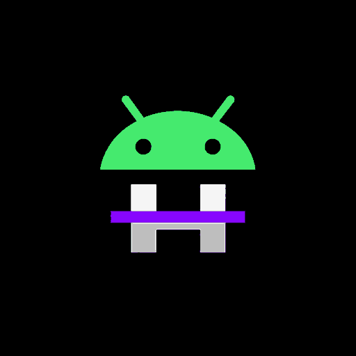

# HorizDroid

  

**HorizDroid** is an Android-focused fork of [Horizon Android](https://github.com/Vasysik/horizon-android).

The project aims to make Horizon a better Android gaming experience through compatibility, performance work, touch and launcher improvements, resource and content support, and expanded mod support.

> HorizDroid is an independent, unofficial community fork. It is not affiliated with or endorsed by the Horizon developers, Mojang, or Microsoft.

## Project goals

- **Android experience:** improve launcher usability, touch controls, lifecycle handling, storage workflows, and device compatibility.
- **Performance and graphics:** investigate rendering, memory, startup, and frame-time improvements while preserving Vulkan and OpenGL ES paths where supported.
- **Mod support:** preserve existing sandboxed/content `.hmod` support and develop an Android-compatible path for native `.hnmod` mods.
- **Resource support:** improve importing, managing, and using supported resource packs, shaders, skins, and other game assets.
- **ARM64 builds:** make reproducible Android builds through GitHub Actions where practical.

## Status

HorizDroid is an active development fork. Features are added and validated incrementally; an item in the goals list is not a claim that it is already implemented.

**Native `.hnmod` loading is not yet implemented or verified on Android.** Horizon's `.hnmod` files are native source/mixin bundles that the desktop launcher uses to build a customised game. Android needs a compatible build-and-load workflow; copying a bundle into storage is not enough to execute it.

Existing `.hmod` content packages use a different format and execution path. Their support must remain intact as native-mod support is developed.

Vulkan and OpenGL ES compatibility and any performance gains must be checked against the actual renderer and tested on real Android devices. No performance gains or device compatibility are claimed until measured.

## Development notes

- [Android native-mod investigation](docs/android-native-mods.md)
- [Horizon Android mod documentation](https://github.com/Vasysik/horizon-android/blob/android/docs/mods.md)
- [Horizon native-mod architecture](https://github.com/Vasysik/horizon-android/blob/android/docs/native-mods.md)

## Building and testing

See [Android build and testing notes](docs/android.md). Do not treat an untested workflow or artifact as a working release.

When reporting bugs, include the device model, Android version, GPU, selected graphics backend, build/commit, and reproducible steps. Do not share account credentials, signing keys, or private tokens.

## Upstream and licensing

HorizDroid is based on [Vasysik's Horizon Android](https://github.com/Vasysik/horizon-android) and retains the upstream repository history. Original copyright notices, licenses, and third-party notices must remain with their respective files and components. Check the applicable licenses before redistributing modified builds or third-party assets.

- [Upstream Horizon Android](https://github.com/Vasysik/horizon-android)
- [TITANIUM performance-mod project](https://github.com/ITS1NEXO/TITANIUM-Horizon-Rust)

---

**HorizDroid — UnRust Your Phone. Rust Your Game.**

Developed by **ZYVIX**.
